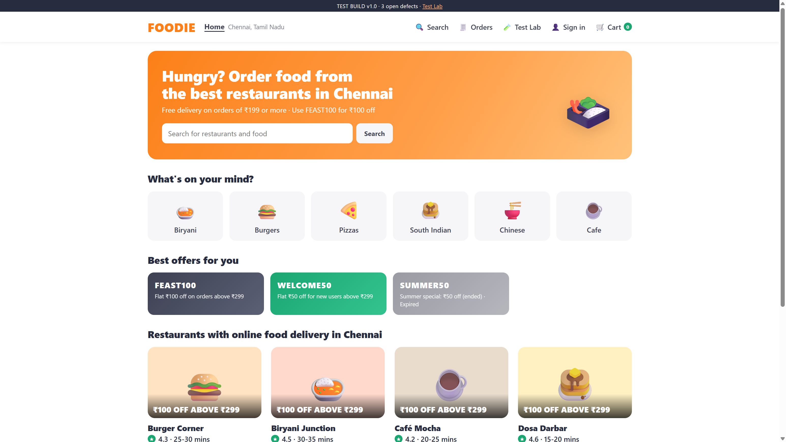
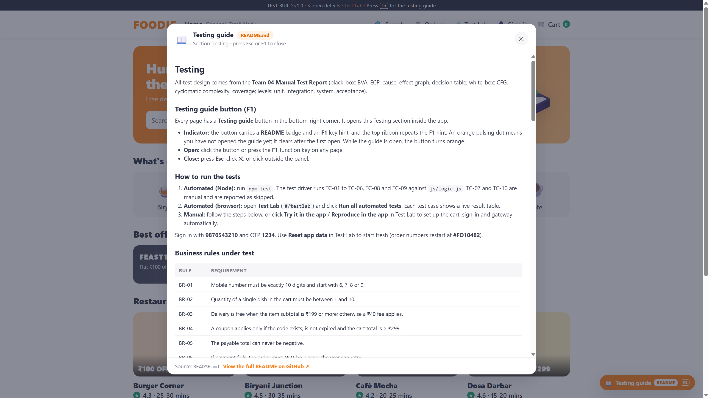
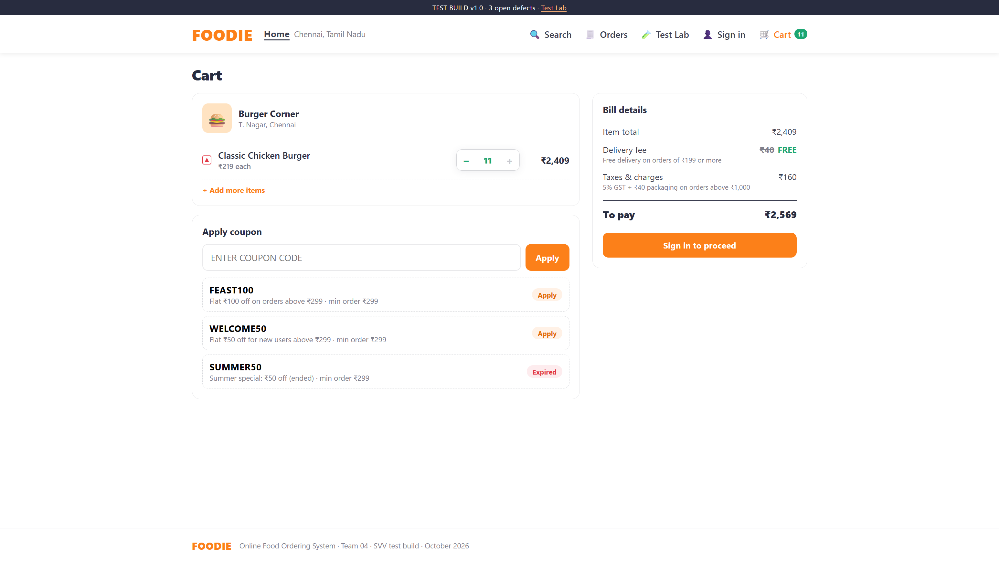
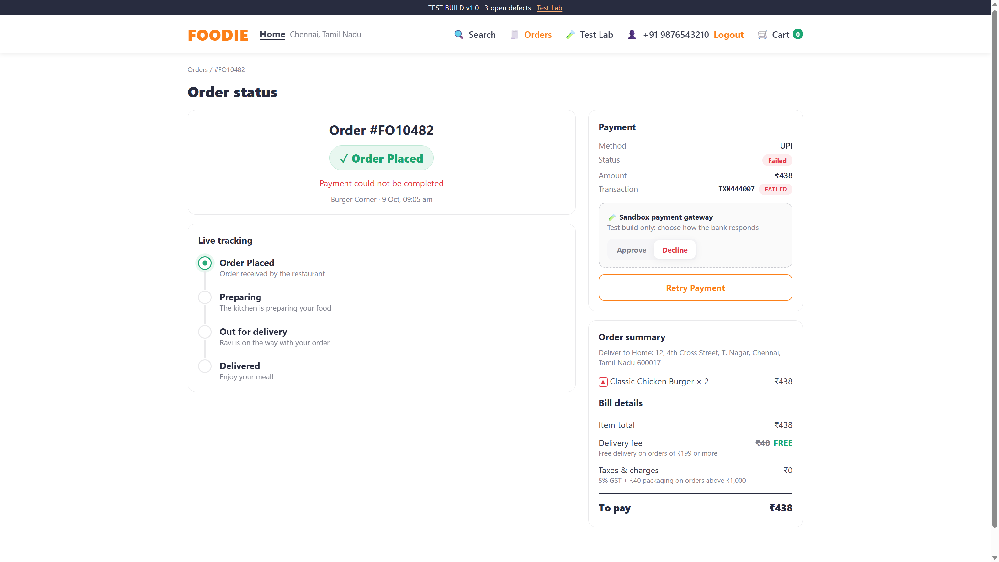
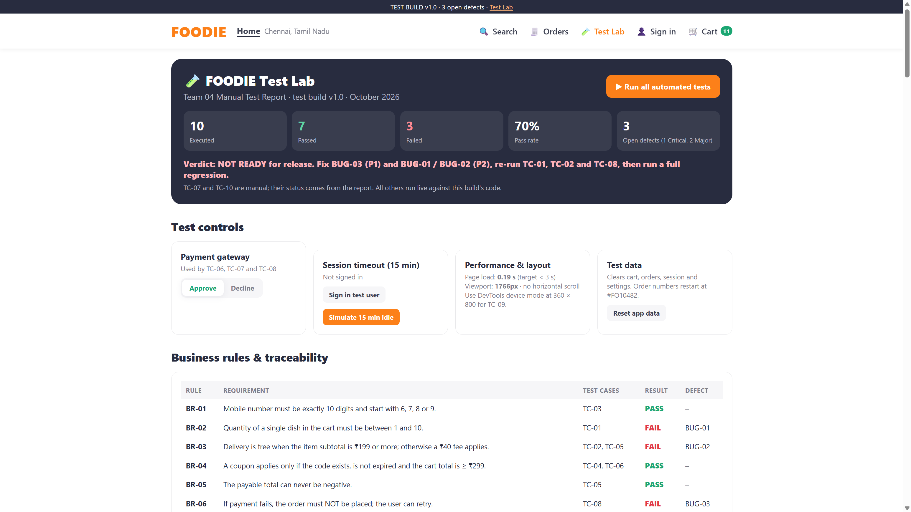

# FOODIE: Online Food Ordering System (SVV test build)

FOODIE is a basic Swiggy-style food ordering web app built as the **system under test** for Team 04's Software Verification & Validation manual test report. A customer signs in with a mobile number, browses restaurants, adds dishes to a cart, applies a coupon, pays online (sandbox gateway) and tracks the order live.

> **This is a test build.** It intentionally ships with the three open defects from the report (BUG-01, BUG-02, BUG-03) so that every test case and defect can be reproduced. See [Testing](#testing).



## Features

- Sign in / sign up with a mobile number and OTP (sandbox OTP `1234`)
- 6 Chennai restaurants with menus, veg/non-veg markers, bestseller tags and a "Veg only" filter
- Search across restaurants, cuisines and dishes
- Cart limited to one restaurant at a time, quantity stepper and typed quantity
- Coupons (`FEAST100`, `WELCOME50`, expired `SUMMER50`) and a full bill breakdown
- Checkout with saved addresses, UPI or card payment and a **sandbox gateway** you can set to Approve or Decline
- Live order tracking (Placed → Preparing → Out for delivery → Delivered), order history and Retry Payment
- 15-minute idle session timeout and a responsive layout down to 360 px
- **Test Lab** page (`#/testlab`) with every business rule, test case and defect, runnable in the browser
- **Testing guide** button (or the **F1** key) on every page that opens this README's Testing section

## Quick start

Requires [Node.js](https://nodejs.org/) 18 or newer. There are no dependencies to install.

```bash
git clone https://github.com/VeNoM-hubs/FoodieTest.git
cd FoodieTest
npm start      # serves the app at http://localhost:5173
npm test       # runs the unit / integration test driver
```

You can also open `index.html` directly in a browser. Everything works except the in-app Testing guide, which then links to this README on GitHub instead.

## Project structure

```text
index.html            App shell (header, test ribbon, Testing guide button)
css/styles.css        Styles (Swiggy-like theme, responsive)
js/data.js            Restaurants, menus and search
js/logic.js           Business logic: validation, billing, coupons, orders, payment, session
js/testcases.js       Business rules, test cases TC-01..TC-10 and defects BUG-01..BUG-03
js/app.js             Single-page app: routing, views, Test Lab, Testing guide
tests/foodie.test.js  Node test driver (node:test) that runs the automated test cases
server.js             Tiny static file server used by npm start
docs/screenshots/     Screenshots used in this README
```

## Testing

All test design comes from the **Team 04 Manual Test Report** (black-box: BVA, ECP, cause–effect graph, decision table; white-box: CFG, cyclomatic complexity, coverage; levels: unit, integration, system, acceptance).

### Testing guide button (F1)

Every page has a **Testing guide** button in the bottom-right corner. It opens this Testing section inside the app.

- **Indicator:** the button carries a **README** badge and an **F1** key hint, and the top ribbon repeats the F1 hint. An orange pulsing dot means you have not opened the guide yet; it clears after the first open. While the guide is open, the button turns orange.
- **Open:** click the button or press the **F1** function key on any page.
- **Close:** press **Esc**, click **✕**, or click outside the panel.



### How to run the tests

1. **Automated (Node):** run `npm test`. The test driver runs TC-01 to TC-06, TC-08 and TC-09 against `js/logic.js`. TC-07 and TC-10 are manual and are reported as skipped.
2. **Automated (browser):** open **Test Lab** (`#/testlab`) and click **Run all automated tests**. Each test case shows a live result table.
3. **Manual:** follow the steps below, or click **Try it in the app** / **Reproduce in the app** in Test Lab to set up the cart, sign-in and gateway automatically.

Sign in with **9876543210** and OTP **1234**. Use **Reset app data** in Test Lab to start fresh (order numbers restart at **#FO10482**).

### Business rules under test

| Rule | Requirement |
| --- | --- |
| BR-01 | Mobile number must be exactly 10 digits and start with 6, 7, 8 or 9. |
| BR-02 | Quantity of a single dish in the cart must be between 1 and 10. |
| BR-03 | Delivery is free when the item subtotal is ₹199 or more; otherwise a ₹40 fee applies. |
| BR-04 | A coupon applies only if the code exists, is not expired and the cart total is ≥ ₹299. |
| BR-05 | The payable total can never be negative. |
| BR-06 | If payment fails, the order must NOT be placed; the user can retry. |
| BR-07 | Pages load in under 3 s; session expires after 15 min idle; layout works on a 360 px screen. |

### Test scenarios

| ID | Module | Scenario | Test cases |
| --- | --- | --- | --- |
| TS-01 | auth | Register and log in with a mobile number | TC-03 |
| TS-02 | menu | Search restaurants and browse the menu | TC-07, TC-10 |
| TS-03 | cart | Add, update and remove items in the cart | TC-01, TC-06 |
| TS-04 | billing | Apply coupon and compute the bill total | TC-02, TC-04, TC-05, TC-06 |
| TS-05 | payment | Check out and pay online | TC-06, TC-07, TC-08 |
| TS-06 | tracking | Track the order status | TC-07, TC-10 |
| TS-07 | help | Open the testing guide from the function button (F1) | UI-01 |
| All | all | Non-functional: layout, session timeout, page load | TC-09 |

### Test cases

| TC | Description | Technique / level | Expected | Report result |
| --- | --- | --- | --- | --- |
| TC-01 | Item quantity boundaries: type 0, 1, 2, 9, 10, 11 in the cart | BVA (BR-02) | 0 and 11 rejected; 1–10 accepted | **FAIL** → BUG-01 |
| TC-02 | Delivery fee at ₹198, ₹199, ₹200 subtotal | BVA (BR-03) | Fee ₹40, ₹0, ₹0 | **FAIL** → BUG-02 |
| TC-03 | Mobile number classes V1, I1–I4 on Sign in | ECP (BR-01) | Only 9876543210 accepted | PASS |
| TC-04 | Coupon rules R1–R4 | Cause–effect graph + decision table (BR-04) | Invalid / expired / add ₹49 more / ₹100 off | PASS |
| TC-05 | `calculateTotal()` basis paths P1–P4 | White-box / unit, V(G) = 4 | ₹250, ₹190, ₹200, ₹0; 100% coverage | PASS |
| TC-06 | 2 × Veg Biryani + FEAST100, cart → bill → payment | Integration (bottom-up) | ₹260 at every interface | PASS |
| TC-07 | Sign in, search, add, coupon, pay by UPI, track | System (functional) | Order confirmed and tracked to delivery | PASS (manual) |
| TC-08 | Pay ₹438 by UPI with the gateway set to Decline | System (negative, BR-06) | "Payment failed"; order not placed | **FAIL** → BUG-03 |
| TC-09 | 360 px layout, 15-min timeout, page load | System (non-functional, BR-07) | No layout issues; timeout; load < 3 s | PASS |
| TC-10 | 4 users outside the team order unaided | Acceptance (alpha UAT) | Order < 2 min; bill correct; live status | PASS (manual) |
| UI-01 | Testing guide opens from the button / F1 (scenario TS-07) | System (UI, help) | Guide panel opens on the Testing section; indicator clears | PASS (extra, not in report) |

**Report summary:** 10 executed · 7 passed · 3 failed · pass rate 70% · 3 defects (1 Critical, 2 Major). **Verdict: NOT READY for release.**

### UI-01: Testing guide opens from the function button

1. In Test Lab, click **Try it in the app** on UI-01 (or **Reset app data**) to reset the indicator.
2. Check that the **Testing guide** button shows the orange pulsing dot, the **README** badge and the **F1** hint.
3. Click the button (or press **F1**).
4. Expected: a panel titled **Testing** opens with the business rules, test cases and defects from this README, plus a link to the full README on GitHub.
5. Close the panel with **Esc**. Expected: the pulsing dot is gone and stays gone after a page reload.
6. In Test Lab, **Run UI-01** performs steps 3–5 automatically.

### Test data cheat sheet

| Value needed | How to build it |
| --- | --- |
| ₹198 | Café Mocha: Veg Club Sandwich (₹99) + Chocolate Brownie (₹99) |
| ₹199 | Café Mocha: Veg Club Sandwich (₹99) + Cold Coffee (₹100) |
| ₹200 | Café Mocha: 2 × Cold Coffee (₹100) |
| ₹250 | Biryani Junction: Chicken Dum Biryani |
| ₹350 | Biryani Junction: Mutton Biryani |
| ₹360 | Biryani Junction: 2 × Veg Biryani (₹180) |
| ₹438 | Burger Corner: 2 × Classic Chicken Burger (₹219) |
| ₹2,409 | Burger Corner: 11 × Classic Chicken Burger (typed, BUG-01) |

Coupons: `FEAST100` (₹100 off, min ₹299, valid), `WELCOME50` (₹50 off, min ₹299, valid), `SUMMER50` (expired), `FOOD99X` (does not exist). Orders above ₹1,000 also pay 5% GST + ₹40 packaging.

### Known defects

| ID | Title | Severity / priority | Test case | Root cause | Suggested fix |
| --- | --- | --- | --- | --- | --- |
| BUG-01 | Cart accepts quantity 11 when typed manually | Major · P2 | TC-01 | Limit enforced only by the "+" button; typed input not validated (`validateQuantity`) | Validate quantity on input and on the server (1–10) |
| BUG-02 | ₹40 delivery fee charged at exactly ₹199 | Major · P2 | TC-02 | `calculateTotal()` line 3 uses `<= 199` instead of `< 199` | Change to `< 199`; add regression tests at ₹198/199/200 |
| BUG-03 | Order shows "Placed" after payment fails | Critical · P1 | TC-08 | Order saved as "Placed" before the payment result; no rollback (`createOrder`, `recordPayment`) | Create orders as "Pending payment"; set "Placed" only on success |

**BUG-01 reproduction:** open Burger Corner, add Classic Chicken Burger, open the cart, type **11** in the quantity box and press Enter. Actual: 11 accepted, item total ₹2,409, to pay ₹2,569.

**BUG-02 reproduction:** build a ₹199 cart (Veg Club Sandwich + Cold Coffee) and open checkout. Actual: delivery fee ₹40, to pay ₹239.

**BUG-03 reproduction:** build a ₹438 cart (2 × Classic Chicken Burger), set the sandbox gateway to **Decline**, pay by UPI. Actual: order #FO10482 shows "Order Placed" while payment is Failed.

| BUG-01 | BUG-03 |
| --- | --- |
|  |  |

### Requirement traceability

| Requirement | Test case(s) | Result | Defect |
| --- | --- | --- | --- |
| BR-01 Mobile number format | TC-03 | PASS | – |
| BR-02 Quantity 1–10 | TC-01 | FAIL | BUG-01 |
| BR-03 Free delivery ≥ ₹199 | TC-02, TC-05 | FAIL | BUG-02 |
| BR-04 Coupon rules | TC-04, TC-06 | PASS | – |
| BR-05 Total never negative | TC-05 | PASS | – |
| BR-06 No order on failed payment | TC-08 | FAIL | BUG-03 |
| BR-07 Non-functional | TC-09 | PASS | – |
| End-to-end ordering & acceptance | TC-07, TC-10 | PASS | – |
| Testing guide (help) | UI-01 | PASS | – |



## Team 04

| Register number | Name | Role in testing |
| --- | --- | --- |
| RA2311033010003 | Bhaskar Lukram | Test planning, test scenarios, Boundary Value Analysis |
| RA2311033010015 | Khushi Raghav | Equivalence Class Partitioning, Cause–Effect Graph, Decision Table |
| RA2311033010045 | Kartik Gupta | White-box testing, code coverage, unit & integration testing |
| RA2311033010044 | Ayush Pandey | System & acceptance testing, defect reporting |
